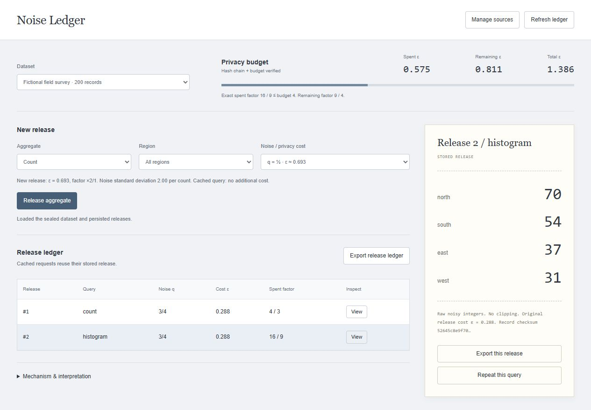

# Noise Ledger

A local differential-privacy workbench with discrete noisy counts, immutable SQLite releases, and exact privacy-budget accounting. Repeating a query returns its original release instead of buying another independent sample.



## Interface

The selected dataset and exact privacy-budget accounting stay above the release workspace. A ledger table sits beside a receipt for the selected noisy release. Source sealing and operator-only counts are grouped in Manage sources. On narrow screens, the release form, receipt, and ledger form a single column.

## Run

Python 3.10+; Node 22+ is needed only for syntax checks and the cross-language export regression test. No runtime packages or external services.

```sh
python run.py --port 8000
```

Open http://127.0.0.1:8000. Seal the fictional survey, release a count, repeat it, and release a histogram. Two releases at q = 1/2 exhaust the example budget; cached queries remain available. Data persists in the ignored `data/noise.sqlite3`. Use `--data PATH` for another store.

## Mechanism and accounting

- One unique participant contributes to one of four public region bins. The adjacency model is adding or removing one participant; count and histogram L1 sensitivity are both 1.
- Each count receives the difference of two independent geometric draws. Exact integer Bernoulli trials use `secrets.randbelow`; there is no floating-point noise inversion or truncation. The noise law is proportional to q^|k|, with epsilon = ln(1/q). Available q values are 1/2, 3/4, and 9/10.
- Composition uses rational products of 1/q. Admission compares this exact product with the sealed integer budget factor. Logarithms are display values only. Histogram bins collectively cost one epsilon under this adjacency model.
- `BEGIN IMMEDIATE` serializes cache lookup, budget admission, sampling, and release insertion. Concurrent duplicates sample once. A failed transaction publishes nothing and spends nothing.
- Canonical record identity prevents renaming or reordering the same dataset to reset its budget. Records and releases are immutable through application operations and SQLite triggers.
- Noisy integers are decimal strings, preserving large values across JavaScript. Negative counts are retained rather than silently clipped.

## Evidence and API

`POST /api/datasets` seals `{name, records: [{id, region}], budget_factor}`. `POST /api/datasets/{id}/release` accepts `{kind, region, level}`; kinds are `count` and `histogram`, and levels are `half`, `three_quarters`, and `nine_tenths`. Histogram region is null. Fresh releases return 201, cached releases 200, exhausted budgets 429, integrity conflicts 409, and invalid inputs 400.

`GET /api/datasets/{id}/ledger` returns the release chain and exact budget factors. The operator endpoint also reveals source counts. The UI exports either a single release or its ledger, excluding participant records, source checksum, and exact counts.

Each exported wrapper includes `release`, `hash`, and `canonical_payload`. Verify SHA-256 over the UTF-8 bytes of **canonical_payload**, then parse that string and compare it with `release`. Do not reserialize the parsed object to verify the checksum: languages can format numeric values differently (for example, 0.0 versus 0). Existing stored payloads remain unchanged. The first previous hash is 64 zeroes; later records link to the preceding checksum.

## Verification

```sh
python -m unittest discover -s tests -v
npm run check
```

Fourteen tests cover exact composition, cache persistence, simultaneous duplicates and competing releases, rollback, immutable storage and tamper detection, source identity, HTTP boundaries, geometric distribution moments, exact likelihood ratios, and a real Node JSON round trip. CI runs Python 3.11/3.13 on Windows and Ubuntu. Browser checks additionally exercised exhausted-budget retries, custom datasets, reloads, and exported records verified against the original SQLite canonical payloads.

## Scope

This is an educational trusted-operator application, not an access-controlled privacy service. Local operator routes expose exact source information; do not expose this server publicly or use sensitive records in the demo. Dataset size and operator metadata are not protected. Overlapping participants across different sealed datasets are not composed together. Hash chains detect accidental modification but are not signatures; a database owner can rewrite history. No encryption, identity management, timing-side-channel protection, or formal implementation certification is provided. Exact geometric sampling has unbounded theoretical runtime. The application bounds datasets to 1,000 participants and 20 sealed sources.

Theory: [Dwork and Roth, The Algorithmic Foundations of Differential Privacy](https://www.cis.upenn.edu/~aaroth/Papers/privacybook.pdf) and [Ghosh, Roughgarden, and Sundararajan, Universally Utility-Maximizing Privacy Mechanisms](https://theory.stanford.edu/~tim/papers/priv.pdf).
